

# e-hud - Colorado Roleplay

HUD con indicadores del personaje, minimapa, ubicación, velocímetro y editor visual.

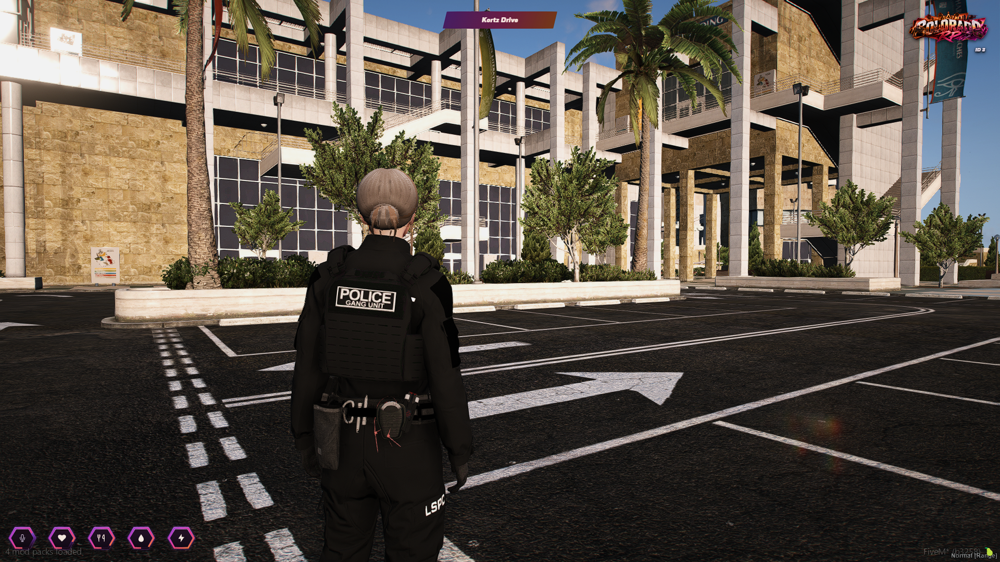

## Indicadores

Vida, armadura, hambre, sed, resistencia, voz y radio. Calle, brújula, velocímetro, marcha, combustible y testigos del vehículo.

## Editor visual

`/hud` abre **Tu espacio**. Permite mover, redimensionar y cambiar el estilo de los elementos.

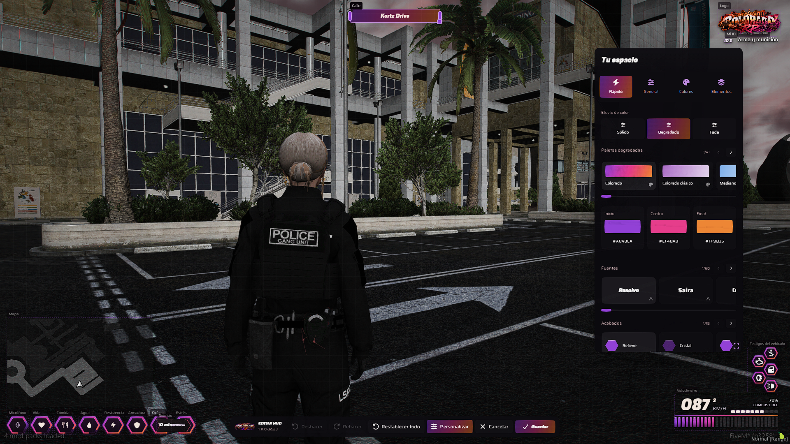

## Paletas y colores

Color sólido, degradado y fade. Colores editables desde el panel.

<table>
  <tr>
    <td width="50%">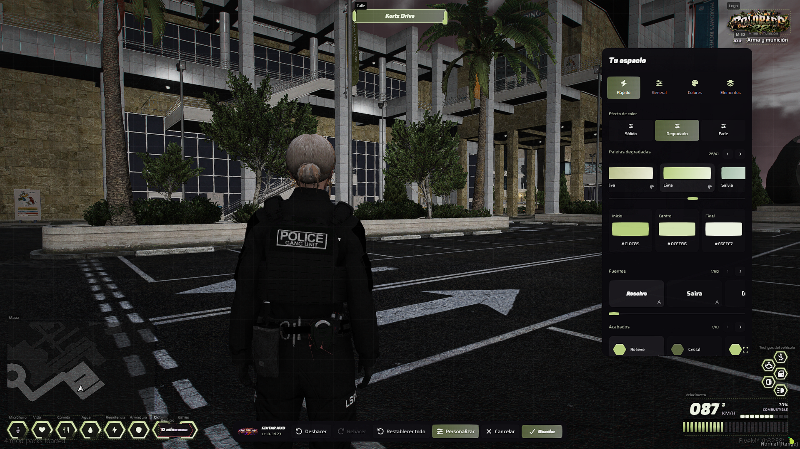</td>
    <td width="50%">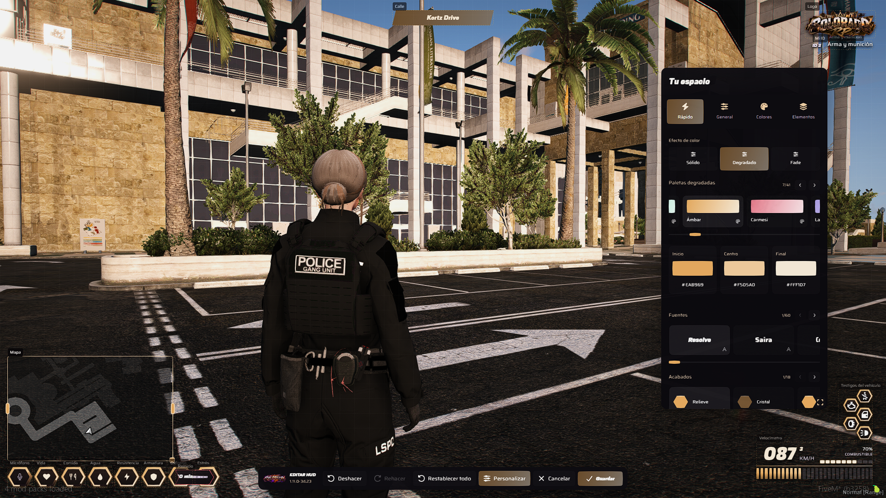</td>
  </tr>
  <tr>
    <td width="50%">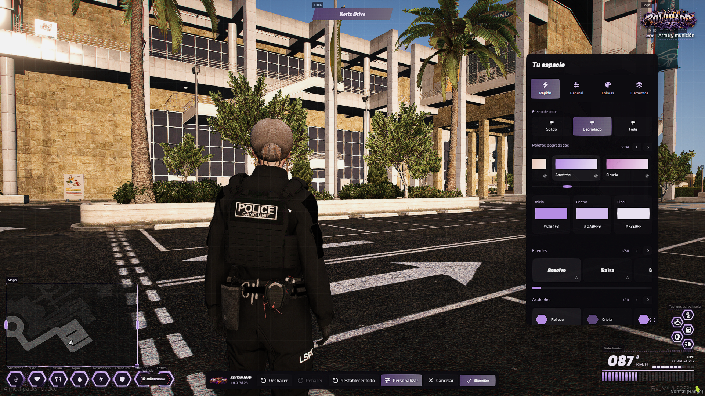</td>
    <td width="50%">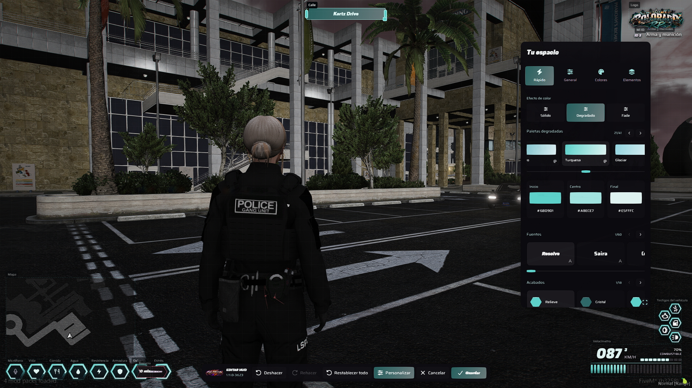</td>
  </tr>
</table>

## Tipografía y acabados

60 fuentes y 18 acabados.

<table>
  <tr>
    <td width="50%">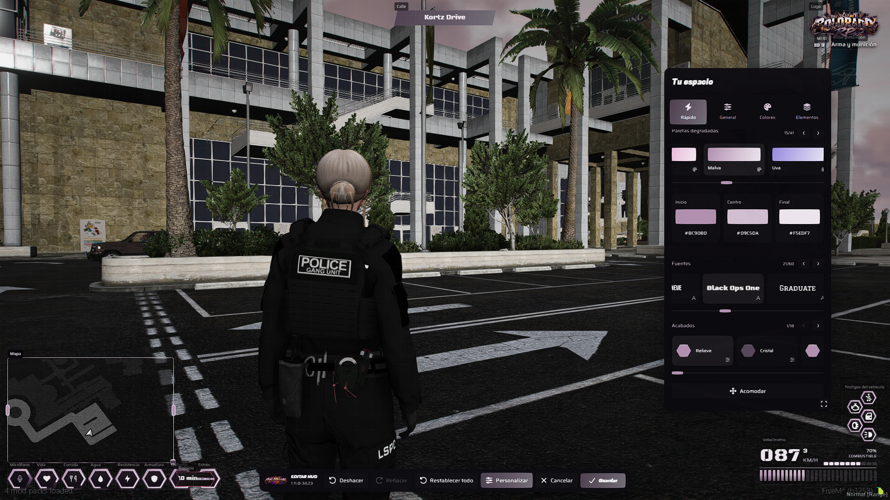</td>
    <td width="50%">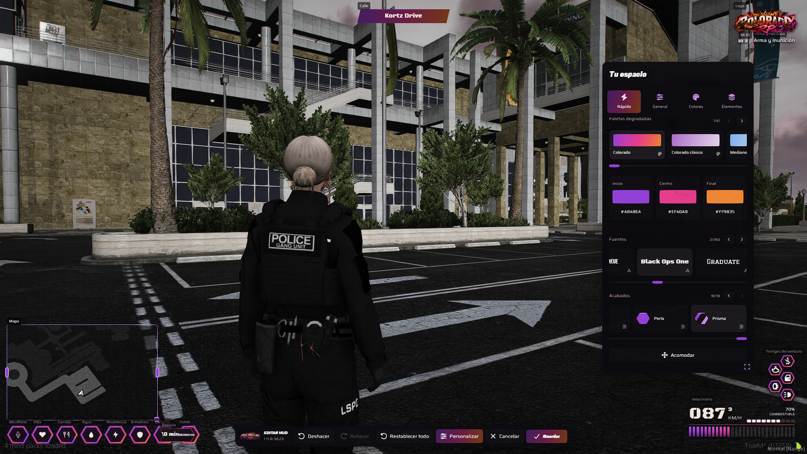</td>
  </tr>
</table>

## Minimapa

Modos normal, 3D y oculto. Posición, tamaño y ancho configurables.

<table>
  <tr>
    <td width="50%">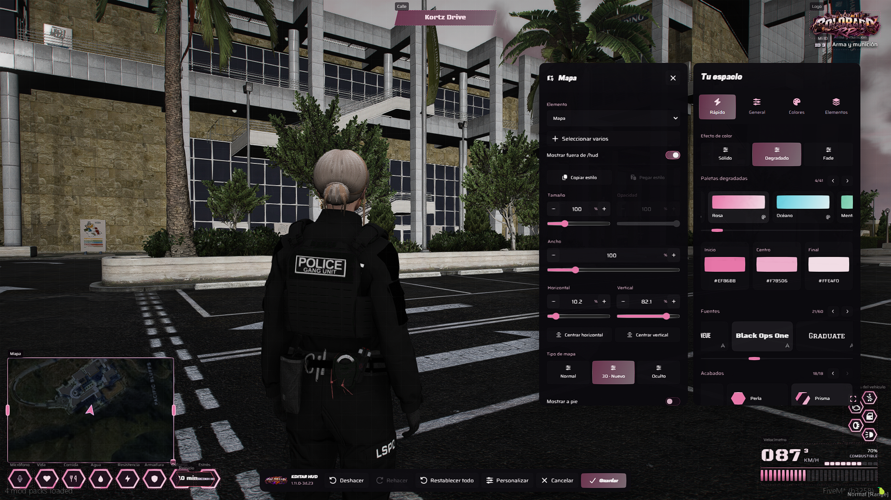</td>
    <td width="50%">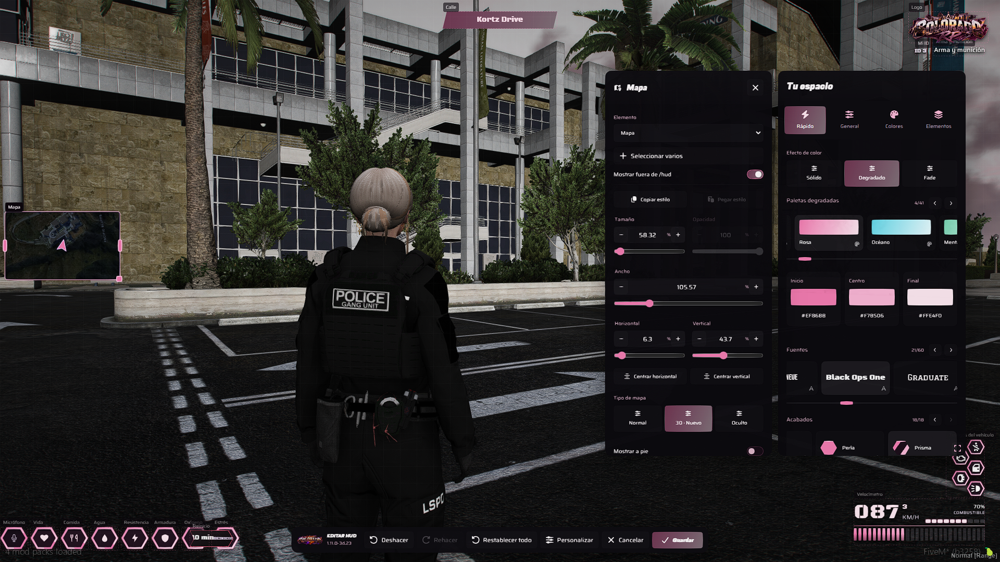</td>
  </tr>
</table>

## Posición y tamaño

Ajustes individuales de posición, escala y visibilidad.

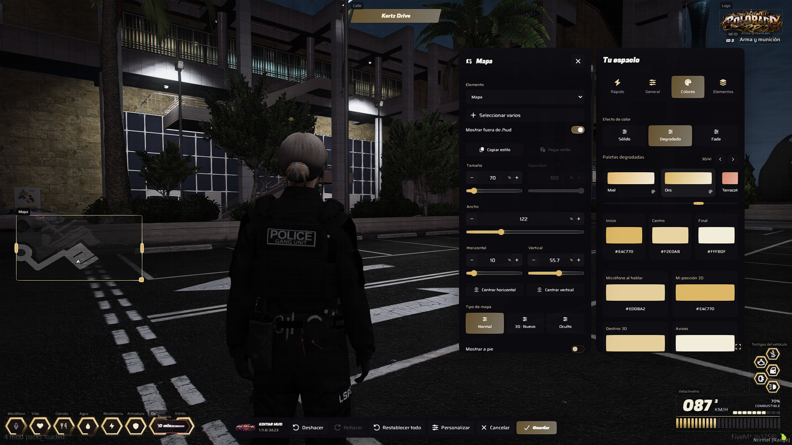

## Selección múltiple

Edición de varios elementos y distribución en fila o columna.

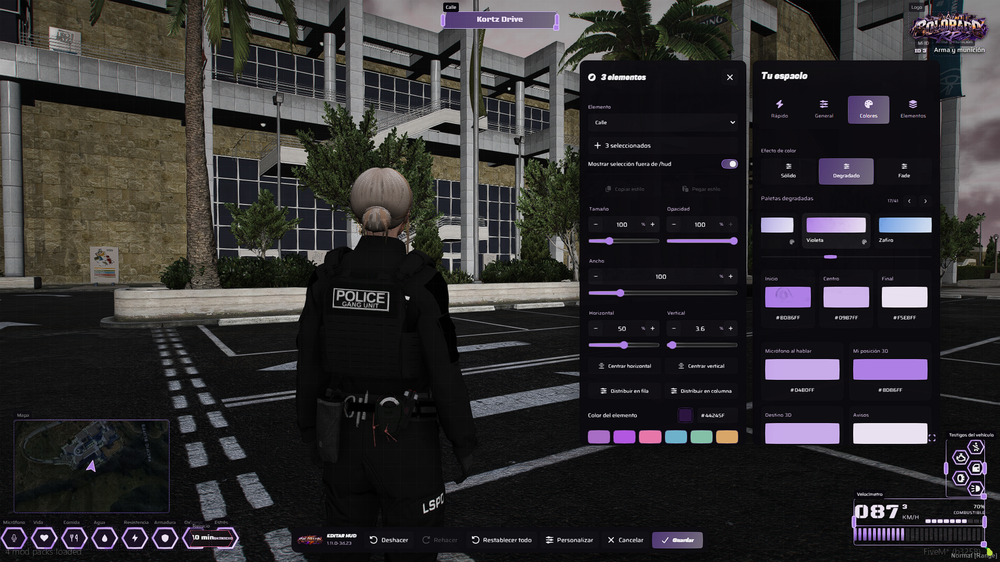

## Autor

Diseño y desarrollo por **EM4NU3L69dll**.

[Perfil](https://github.com/em4nu3i69dll) · [Portafolio](https://em4nu3l69dll.dev/)
